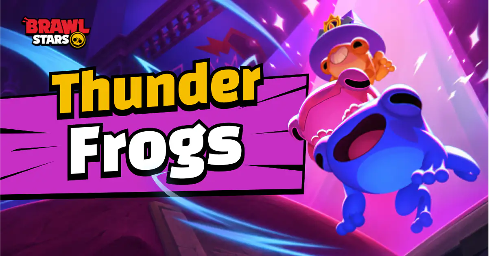
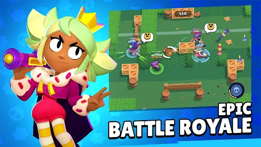
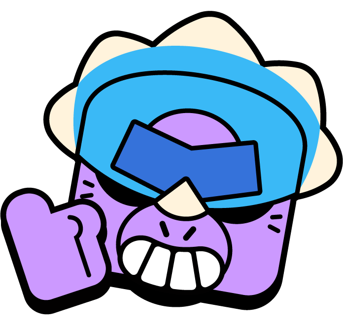
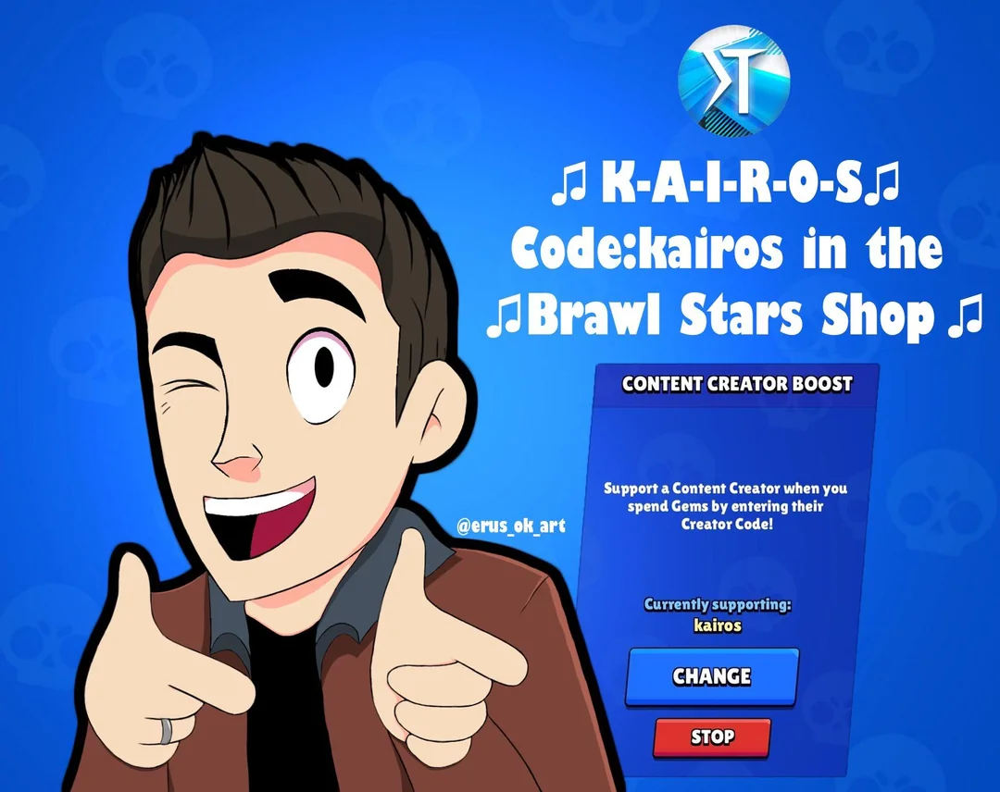
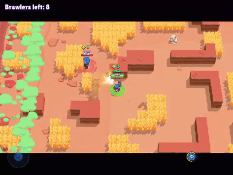
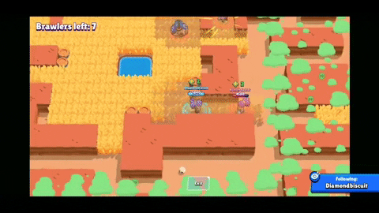
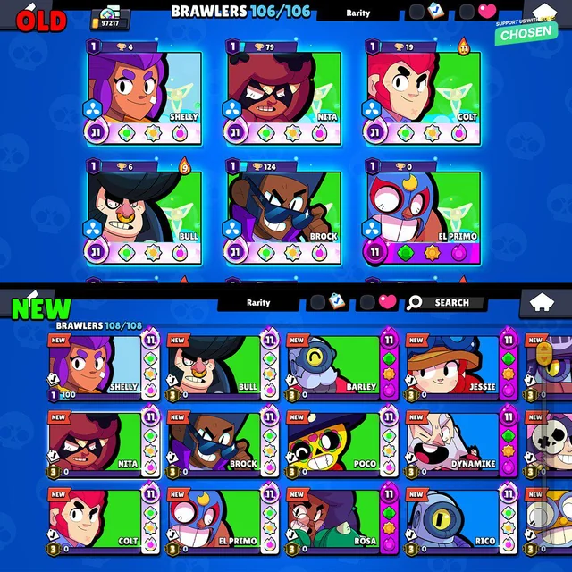

<!DOCTYPE html>
<html lang="zh-Hant">

<head>
  <meta charset="UTF-8">
  <title>荒野亂鬥介紹網頁</title>
  
  <link rel="stylesheet" href="https://cdn.jsdelivr.net/npm/swiper@11/swiper-bundle.min.css" />

  
</head>

<body>
  <ul>
    <li></li>
    <li class="word"><a class="active" href="#home">首頁</a></li>
    <li class="word"><a href="#introduction">簡介</a></li>
    <li class="word"><a href="#skills">戰鬥技巧</a></li>
    <li class="word"><a href="#brawlers">英雄介紹</a></li>
    <li class="word"><a href="#new">全新角色</a></li>
    <li class="word"><a href="#nb">全新更新</a></li>
    <li class="word"><a href="#search">搜尋問答</a></li>
  </ul>
  
  

  
  

    
 
      

        
        

          
          

            <h3>進入荒野，開始亂鬥！</h3>
            
在三分鐘內完成快節奏對戰，與好友並肩作戰！

          

        

        

          
          

            <h3>刺激的排位賽!</h3>
            
測試出你真正的實力!!!

          

        

        
        

          
          

            <h3>2026全新英雄</h3>
            
等待更精彩的活動!

          

        

        
        

          
          

            <h3>皇家活動</h3>
            
等待更刺激的皇家戰鬥!

          

        

      

      

      

      

      
    

  

</body>
    
歡迎來到荒野的世界!

  
目前在這個「荒野」裡，已經有 111 位強大英雄等著你解鎖！

  
  
簡介

  
在這個荒野裡，有多種模式：荒野死鬥，寶石爭霸，亂鬥足球，淘汰賽...

  
這些模式都可以與好朋友並肩作戰!

  
不但可以增進與好朋友的關係還可以練習許多戰鬥技巧!

  
荒野死鬥：有分三人，二人與一人

  
  <aside> 
       
      
如果想來觀看kairos的頻道，快來點擊圖片!另外，並在brawl stars支持他！
 
  </aside>

  

    

      
單人模式：

      
    

    

      
雙人模式：

      
    

    

      
三人模式：

      
    

  

  
戰鬥技巧

  <h1>carl(卡爾)的戰鬥技巧!</h1>
  

    

      
卡爾的最推薦配件是!飛天鉤爪!(flying hook)

      
這是它的介紹!

      
    

    

      
這是它的使用方式:

      
    

  

  <h1>penny(佩妮)的戰鬥技巧!</h1>
  

    

      
當佩妮的子彈打到人時，子彈會散開並對周圍的人造成傷害。

      
這是它的使用方式:

      
    

  

  <h1>shelly(雪莉)的戰鬥技巧!</h1>
  

    

      
雪莉的超級緒能不但可以造成極大傷害，也能將對手擊退。

      
這是它的使用方式:

      
    

  

  
英雄性能與介紹(常見角色)

  

    

      <h1><a href="https://brawlstars.fandom.com/wiki/Shelly">雪莉</a></h1>
      

      稀有度： 
      初始英雄 
      職業: 
      輸出 
      移動速度： 
      770（快） 
      924（使用極限威能） 
      2400（使用配件）

    

    

      <h1><a href="https://brawlstars.fandom.com/wiki/Colt">柯爾特</a></h1>
      

      稀有度： 
      稀有 
      職業： 
      輸出 
      移動速度： 
      720（普通） 
      814（裝備星之能量） 
      864（裝備極限威能） 
      958（裝備星之能量和極限威能）

    

    

      <h1><a href="https://brawlstars.fandom.com/wiki/Dynamike">爆破麥克</a></h1>
      

      稀有度： 
      超稀有 
      職業： 
      壓制 
      移動速度： 
      770（快） 
      814（裝備星之能量） 
      864（裝備極限威能） 
      958（裝備星之能量和極限威能）

    

    

      <h1><a href="https://brawlstars.fandom.com/wiki/Gus">格斯</a></h1>
      

      稀有度： 
      超稀有 
      職業： 
      支援 
      移動速度： 
      750（普通）

    

    

      <h1><a href="https://brawlstars.fandom.com/wiki/Edgar">艾德加</a></h1>
      

      稀有度： 
      史詩 
      職業： 
      刺客 
      移動速度： 
      820（極快） 
      1020（使用超級續能後） 
      984（裝備極限威能） 
      958（裝備極限威能且使用超級續能後）

    

    

      <h1><a href="https://brawlstars.fandom.com/wiki/Fang">范</a></h1>
      

      稀有度： 
      神話 
      職業： 
      刺客 
      移動速度： 
      770（快） 
      924（裝備極限威能） 
      4000(裝備超級續能)

    

    

      <h1><a href="https://brawlstars.fandom.com/wiki/Vince">文斯</a></h1>
      

      稀有度： 
      神話 
      職業： 
      輸出 
      移動速度： 
      750（普通）

    

    

      <h1><a href="https://brawlstars.fandom.com/wiki/Chester">查斯特</a></h1>
      

      稀有度： 
      傳奇 
      職業： 
      輸出 
      移動速度： 
      770（快） 
      920（裝備武裝配件） 
      955（裝備極限威能） 
      1105（裝備武裝配件和極限威能）

    

    

      <h1><a href="https://brawlstars.fandom.com/wiki/Nori">憲</a></h1>
      

      稀有度： 
      傳奇 
      職業： 
      刺客 
      移動速度： 
      855（超快） 
      1026（裝備星之能量）

    

    

      <h1><a href="https://brawlstars.fandom.com/wiki/Sirius">西里烏斯</a></h1>
      

      稀有度： 
      超凡 
      職業： 
      控場 
      移動速度： 
      720（普通） 
      864（裝備極限威能）

    

  

  
全新角色!

  
英雄種類：輸出者、坦克、刺客、狙擊手、控場者、輔助、投擲者。

  
我們現在2026年11月~2027年1月的最新英雄有3個!:thunderfrogs (雷蛙)，雷 (Rey)與露比 (Ruby)

  

    
  

  
全新更新!

  
每個賽季都有特別的遊戲主畫面與活動!2026的更新如下:

  <h1>全新排位賽!</h1>
  
最近荒野亂鬥更新了排位賽，讓排位賽變得更刺激!

    
  
大家一起來下載brawlstars吧!

  
下載網址: <a href="https://play.google.com/store/apps/details?id=com.supercell.brawlstars&hl=zh_TW">點我前往 Google Play 下載</a>

  
<b>Pictures from:</b> frantkit.com, google

  

    

      
在這裡輸入問題，我會回答你...

      <input type="text" id="userInput" placeholder="例如：你好 / 這個網站在介紹什麼？">
      <button onclick="respond()">送出</button>
    

    <form action="" style="text-align: center; margin-bottom: 20px;">
      <label for="lan" style="color: white;">choose a language:</label>
      <select id="lan" name="lan" style="font-size: 20px; padding: 5px;">
        <option value="chinese">chinese</option>
        <option value="english">english</option>
        <option value="japanese">japanese</option>
        <option value="chinese(china)">chinese(china)</option>
      </select>
    </form>
  

  

  

  

  <footer>
    
本版本有著作權；請勿冒仿!!!

    
本版本網址:file:///Q:/%E6%88%91%E7%9A%84%E9%9B%B2%E7%AB%AF%E7%A1%AC%E7%A2%9F/Students/ryderwang/brawlstarsweb.html

    
本網站適用於教學

    
網站製作人:王懷謙

  </footer>
</body>
</html>
